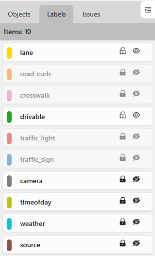
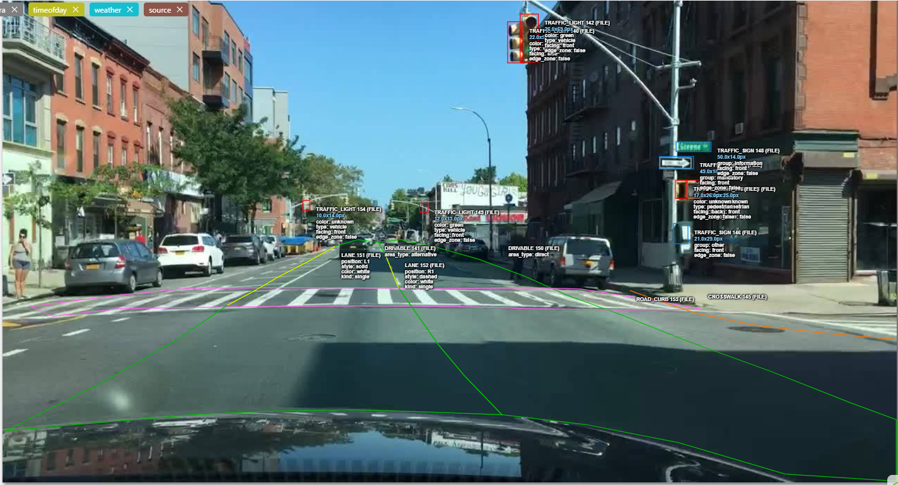
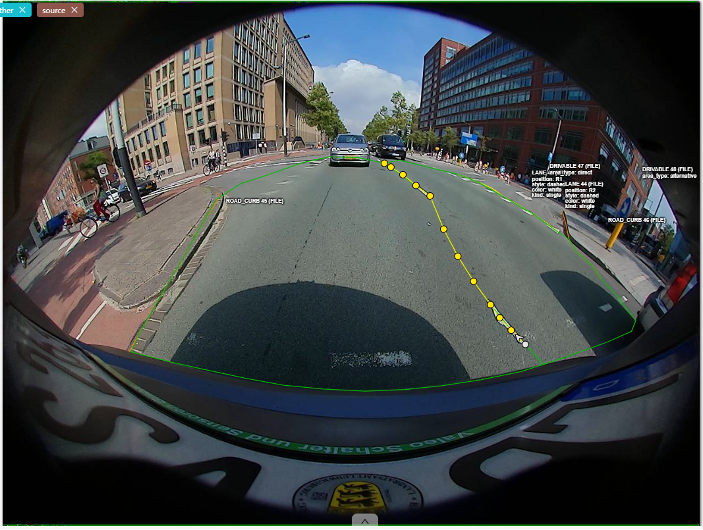
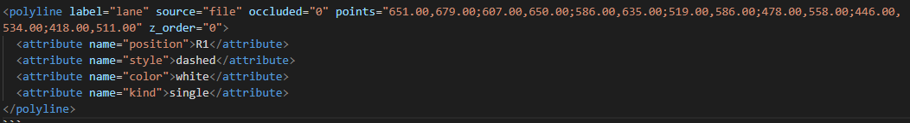

# Báo cáo cá nhân — Ngày 11

- **Họ tên** · Nguyễn Viết Minh Hoàng
- **Mã học viên** · 2A202603281
- **Phiên bản CVAT** · 2.74.1*.
- **Guideline** · Road v1.0
- **Lần nộp** · `revision = 1` theo manifest hiện tại.
- **Thời điểm export** · Front 09:29:46 ngày 21/11/2026, fisheye 19:13:37 ngày 20/11/2026. Thời gian lấy từ metadata CVAT và quy đổi sang giờ Việt Nam.
- **Số lần nộp lại sau Rework** · 0 theo revision hiện tại. Bản front đã được chỉnh trước khi tạo manifest lần 1.

## 1. Kiểm project

| Mục | Đúng như guideline Road v1.0? | Ghi chú |
| --- | --- | --- |
| 6 label, đúng kiểu | Có | `lane` và `road_curb` là polyline. `crosswalk` và `drivable` là polygon. `traffic_light` và `traffic_sign` là rectangle. |
| Thuộc tính và giá trị | Có | Kiểu nhập, giá trị mặc định và danh sách giá trị trong metadata của cả hai ZIP khớp cấu hình Road v1.0. |
| 4 tag ảnh | Có | 20/20 ảnh có đủ `camera`, `timeofday`, `weather` và `source`. Tag `camera` khớp tên ảnh. |

**Kết thúc polyline** · Đặt điểm từ gần xe ra xa, sau đó bấm `N` để kết thúc.  
**Đặt tag ảnh** · Chọn công cụ Tag, chọn label, chọn `value` theo ảnh rồi kiểm lại trong bảng Objects.

## 2. Số lượng đã gán

| Task | Ảnh | lane | road_curb | crosswalk | drivable | traffic_light | traffic_sign |
| --- | ---: | ---: | ---: | ---: | ---: | ---: | ---: |
| front | 12 | 33 | 5 | 4 | 22 | 23 | 19 |
| front-extra (đã làm 0 / 4) | 0 | 0 | 0 | 0 | 0 | 0 | 0 |
| fisheye | 8 | 5 | 4 | 8 | 9 | 6 | 0 |
| fisheye-extra (đã làm 0 / 4) | 0 | 0 | 0 | 0 | 0 | 0 | 0 |

Tổng cộng 20 ảnh, 138 shape và 80 tag.

## 3. Bảng ca khó

| Ảnh | Nhãn | Phân vân giữa | Đã chọn | Lý do |
| --- | --- | --- | --- | --- |
| A04 | `lane L1` | Vạch đơn hoặc vạch đôi | `solid / yellow / double` | Hai nét vàng liền song song tạo ranh trái. |
| A05–A09 | `lane L1/R1` | Để trống khi chưa thấy vạch hoặc biểu diễn biên làn suy luận | Bản front hiện tại có sáu polyline suy luận, dùng `color=other`. | Ước lượng biên từ vùng lái và mép đường tại các vị trí chưa thấy vạch sơn đủ rõ. Cách diễn giải các biên này cần coach xác nhận. |
| A06 | `drivable / direct` | Phạm vi bên phải của vùng lái ở đoạn sau vạch qua đường | Chỉnh lại một số đỉnh biên phải trong bản export mới. | Căn lại đường bao vùng lái ở đoạn có cột và mép đường khó tách trên ảnh. |
| B06, B08 | `lane` | `L1/R1` hoặc `other` | `position=other` | Road v1.0 dùng `other` cho vạch trên camera hai bên. |

## 4. Phiếu QC 1 nhận được

**Người kiểm lô và quyết định chính thức** · Cần điền theo phiếu QC chéo nhận được.

Phiếu QC mô phỏng trên bản nhãn ban đầu của A01–A06 đề xuất Rework với 5 lỗi chính trên 51 nhãn (9,8%). Bảng dưới ghi kết quả đối chiếu phiếu mô phỏng và cảnh báo lint với ZIP front hiện tại.

| Mã lỗi | Số lỗi | Đồng ý? | Đã sửa? |
| --- | ---: | --- | --- |
| QC1-04 | 3 ca trong QC mô phỏng | Ghi nhận để rà lại tâm vạch. | Ba polyline được nêu trên A01–A03 có cùng tọa độ như bản trước. |
| QC1-07 | 2 ca trong QC mô phỏng | Ghi nhận để kiểm mép capô và phạm vi vạch qua đường. | Hai polygon được nêu là `drivable / alternative` của A04 và `crosswalk` của A06 chưa đổi hình học. Polygon `drivable / direct` của A06 đã được chỉnh riêng. |
| QC1-02 | 6 cảnh báo lint ở bản front trước | Ghi nhận sáu vị trí bị thiếu trong XML. | Đã thêm A05 L1/R1, A06 R1, A07 L1, A08 L1 và A09 R1 dưới dạng đường biên suy luận. Lint trên bản hiện tại báo 0 cảnh báo. |

## 5. Kiểm file export

| File | Mở lại được? | Số shape ảnh 1 (job / file) | Số shape ảnh 2 (job / file) | Tag camera có trong XML? |
| --- | --- | --- | --- | --- |
| `nguyenvietminhhoang-front.zip` | Có, đọc được `annotations.xml` | A01 · cần đối chiếu job / 7 | A02 · cần đối chiếu job / 5 | Có, 12/12 ảnh dùng `front`. |
| `nguyenvietminhhoang-fisheye.zip` | Có, đọc được `annotations.xml` | B01 · cần đối chiếu job / 2 | B02 · cần đối chiếu job / 8 | Có, 8/8 ảnh khớp mã camera theo tên file. |

Hai ZIP chỉ chứa `annotations.xml` theo định dạng CVAT for images 1.1. SHA-256 của cả hai ZIP khớp manifest `revision = 1`. Kết quả lint là **20 ảnh, 0 cảnh báo**.

## 6. Ảnh chụp màn hình

- [ ] Tab **Labels** trong CVAT.

- [ ] Ảnh front **A12** hiển thị làn, vùng lái và đèn hoặc biển.

- [ ] Ảnh fisheye **B03** phóng to đoạn polyline cong.

- [ ] Ảnh chụp XML của bộ front, hiển thị thẻ `<polyline label="lane">` và thuộc tính.

## 7. Tự đánh giá

Trong mẫu QC A01–A06, lỗi chính xuất hiện nhiều nhất là **QC1-04**, với ba polyline lệch tâm vạch. Ở Ngày 20, em sẽ phóng to ảnh, đặt điểm trên tâm từng đoạn sơn rồi rà lại các đoạn nối trước khi lưu.

Polyline làn được dùng để nội suy tọa độ đích `x` ở từng hàng neo của mô hình row-anchor. Trong bản front mới, em đã bổ sung sáu vị trí `L1/R1` mà lint báo thiếu. Khi vạch thật nhìn thấy mà bị bỏ sót, mô hình có thể nhận đích “không có làn” ở những hàng đáng lẽ phải có tọa độ. Nếu một đường biên suy luận lệch khỏi vạch thật, mô hình cũng sẽ học tọa độ lệch. Vì vậy, em cần đối chiếu ảnh gốc trước khi dùng các nhãn này làm dữ liệu huấn luyện.

## 8. (Tùy chọn, buffer) Từ polyline đến đích row-anchor

Chưa thực hiện phần so sánh tọa độ với bạn được kiểm.
